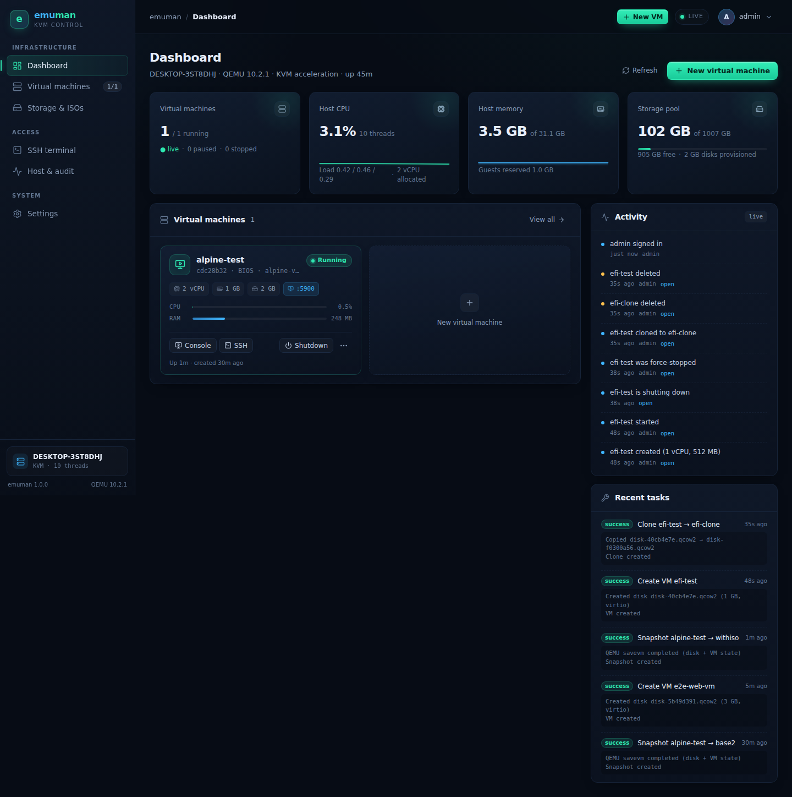
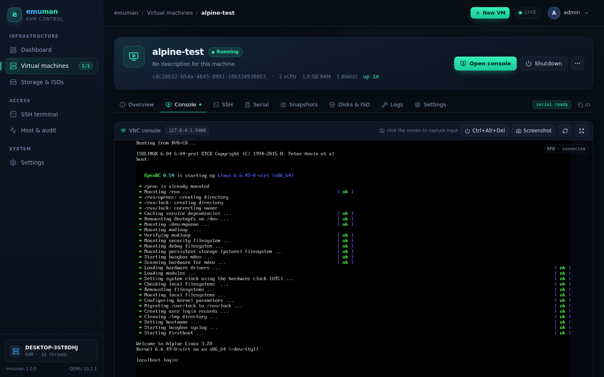
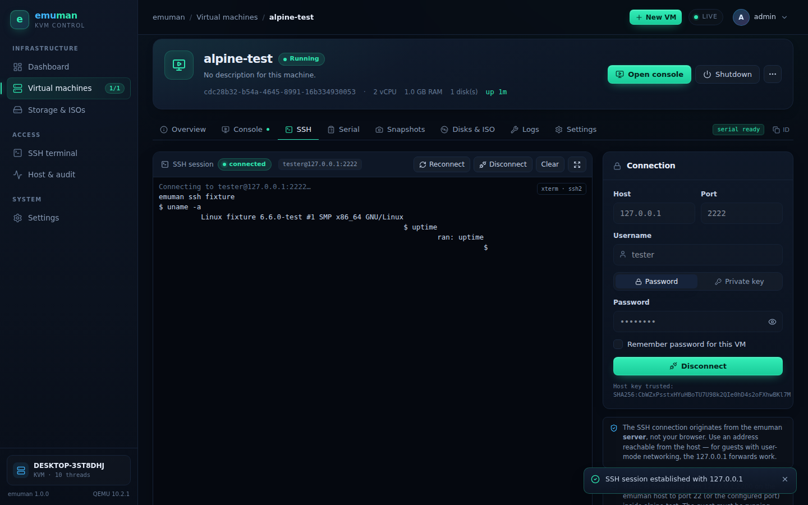
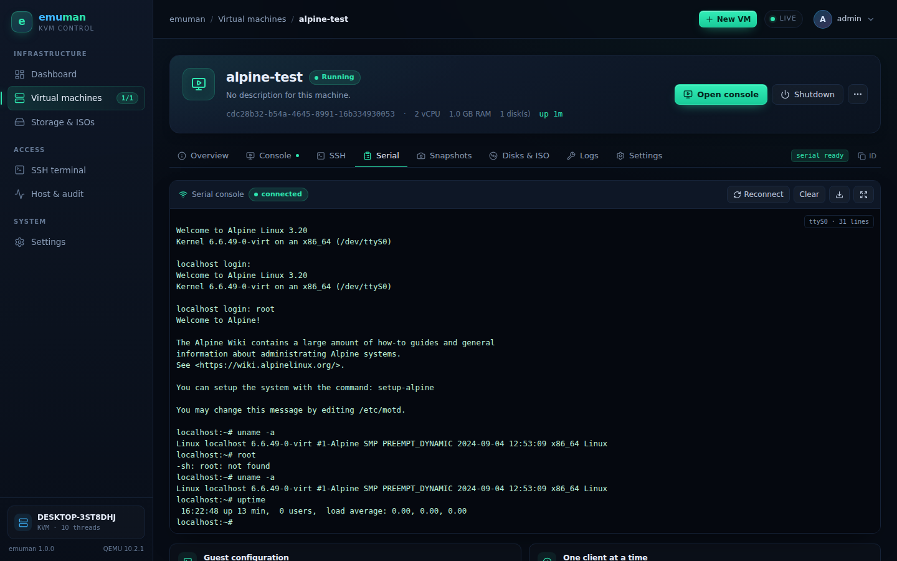
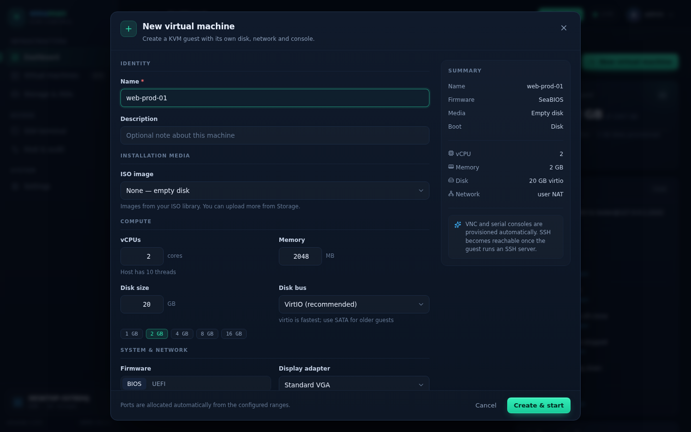
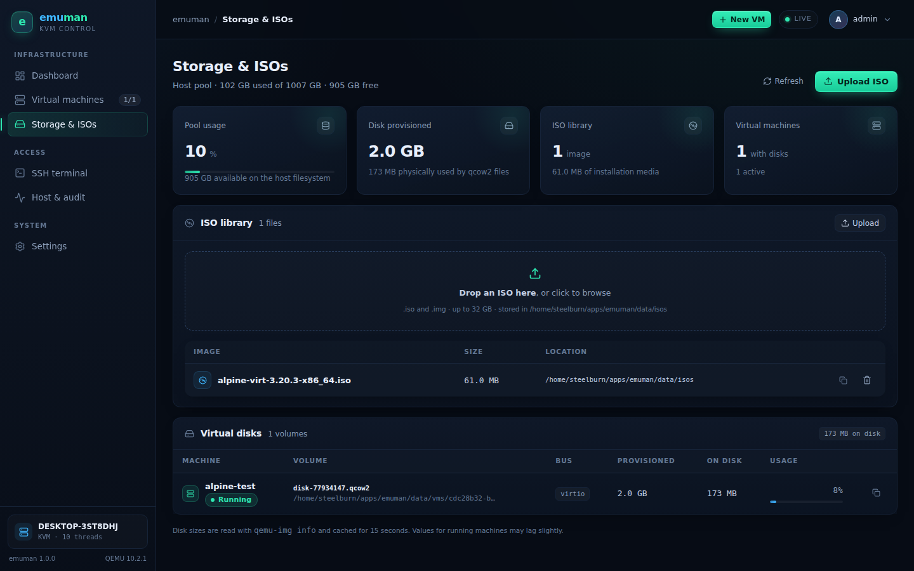
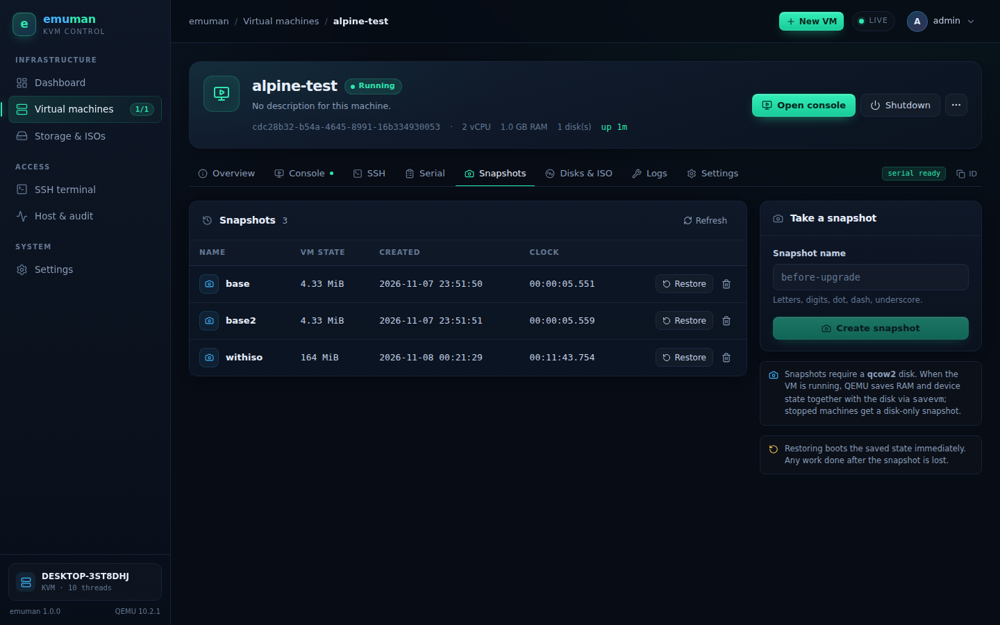
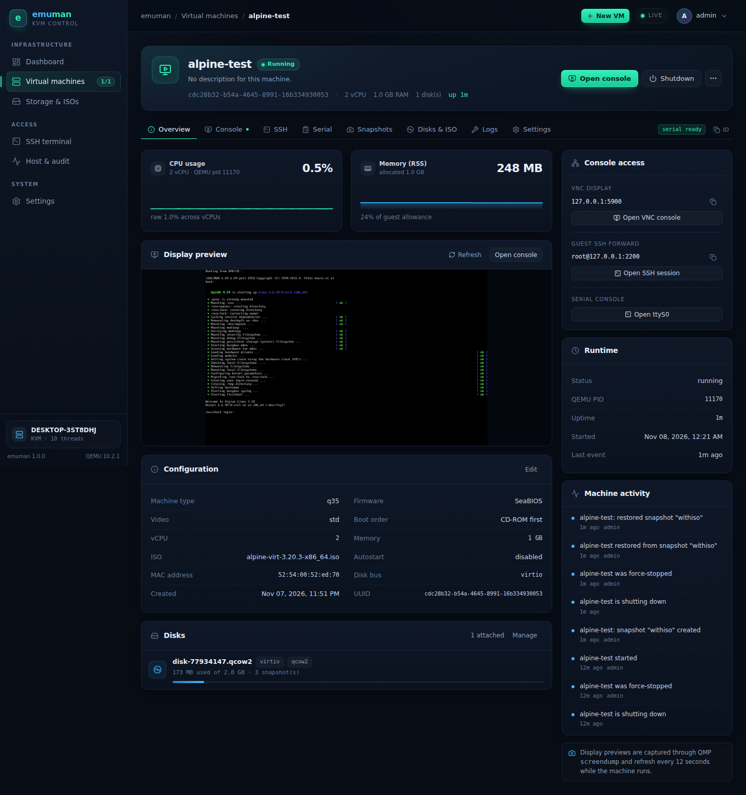
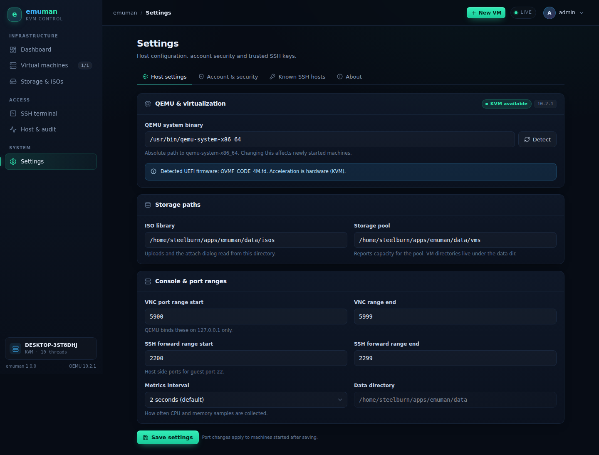
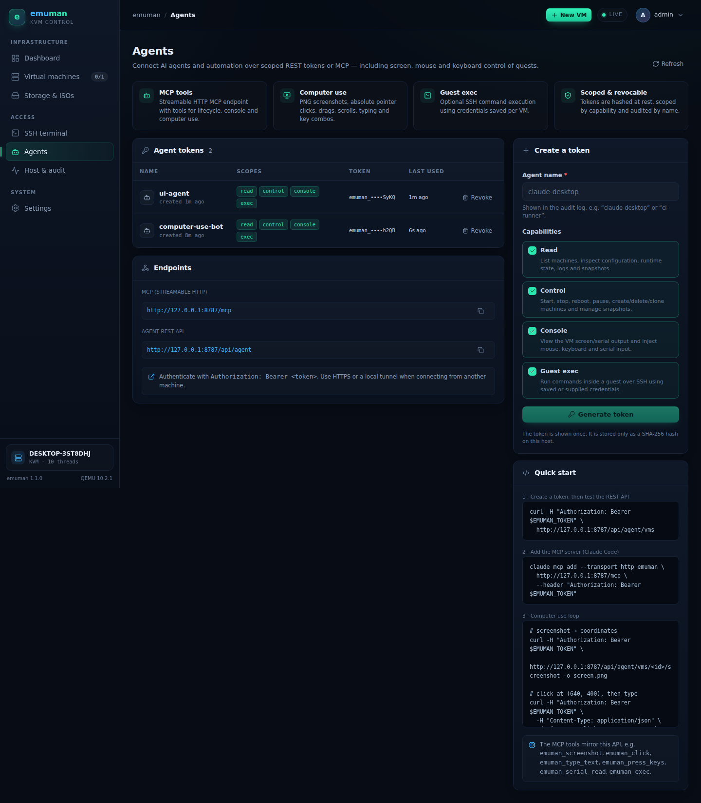

# emuman

**A self-hosted web console for KVM/QEMU.** Manage virtual machines, watch live telemetry, and
open VNC, SSH or serial consoles from the browser — inspired by the operational feel of Proxmox
and Portainer, without the libvirt stack.



## Why emuman?

- **QMP-native.** Talks directly to QEMU's Machine Protocol over unix sockets. No libvirt daemon,
  no XML, no extra service to babysit.
- **Consoles included.** noVNC over authenticated WebSockets, an integrated SSH terminal (ssh2),
  and the QEMU serial chardev — no client plugins or extra ports.
- **Designed for a single host.** Everything lives in one Node process and one data directory.
  Easy to run on a home lab box, a workstation, or a small server.
- **Real operations, not a mock.** Lifecycle actions, graceful shutdown, snapshots with VM state,
  cloning, disk hot-plug, ISO uploads, EFI, port allocation, audit trail, task history and
  host metrics.

| VNC console | SSH terminal |
| --- | --- |
|  |  |

| Serial console | Create a VM |
| --- | --- |
|  |  |

## Features

### Machines
- Create guests with BIOS or UEFI (OVMF), virtio or SATA disks, standard/virtio/QXL video.
- Boot order, ISO attach/detach, autostart, extra QEMU arguments.
- Start, graceful shutdown (guest agent, then ACPI), force stop, reset, pause/resume.
- Live status, PID, uptime, CPU/RAM telemetry and a QMP framebuffer preview.
- Clone a stopped machine (full qcow2 copy, new IDs/MAC/ports).
- Delete with disk cleanup.

### Storage
- qcow2 disk creation, thin provisioning, grow-only resize.
- Hot-plug virtio disks into running guests through QMP.
- ISO library with streaming upload, attach/detach and in-use protection.
- Per-VM and host-wide capacity reporting (qemu-img info, `statfs`).

### Snapshots
- Create/delete/list qcow2 snapshots.
- Running guests get RAM + device state through QEMU `savevm`.
- Restore boots the saved state directly with `-loadvm`.

### Consoles
- **VNC** — QEMU binds to `127.0.0.1`; emuman proxies RFB to noVNC over a session-authenticated
  WebSocket. Ctrl+Alt+Del, screenshot, fullscreen.
- **SSH** — server-side ssh2 bridge with password or private-key auth, PTY resize, scrollback,
  host-key pinning (TOFU) and encrypted per-VM credential storage.
- **Serial** — attach to the emulated UART, replay buffered output, download the log.
- Quick-jump terminal for the host or any guest forward.

### Agents & computer use
- **Scoped agent tokens** — `read`, `control`, `console`, `exec`; hashed at rest and revocable.
- **MCP server** at `/mcp` (Streamable HTTP) with 22 tools for lifecycle, snapshots, serial, SSH
  exec and computer use.
- **Computer use** — PNG screenshots, absolute pointer moves/clicks/drags/scrolls, typing and key
  combinations through QMP.
- Plain **REST API** at `/api/agent` for custom agents, with CORS and audit attribution.
- Full guide: [`docs/agents.md`](docs/agents.md).

### Operations
- Live host CPU/memory/load/storage with sparklines.
- Audit log for auth, VM, disk, ISO, snapshot, settings and SSH actions.
- Task history for long-running operations (create, clone, snapshot, hot-plug).
- First-run administrator setup, scrypt password hashing, 30-day HttpOnly sessions,
  login rate limiting, CSRF-resistant API.
- **Multi-user access with roles** — administrators, operators and read-only viewers, with
  per-role API/WebSocket enforcement and first-sign-in password changes.
- Runtime log viewer and machine logs.

## Requirements

- Linux with KVM (`/dev/kvm`) recommended — software emulation (`TCG`) works but is slow.
- QEMU (`qemu-system-x86_64`, `qemu-img`) 8.0 or newer.
- Node.js 20+ (tested on 22).
- Optional: OVMF firmware for UEFI guests (`/usr/share/OVMF/OVMF_CODE_4M.fd` is auto-detected).
- Optional: a bridge (`br0`) if you want bridged networking instead of user-mode NAT.

Ubuntu/Debian:

```bash
sudo apt install qemu-system-x86 qemu-utils ovmf nodejs npm
```

## Quick start

```bash
git clone <this repo> emuman
cd emuman
npm install
npm run build
npm start
```

Open `http://<host>:8787`. The first visit creates the administrator account. Data (users, VM
configs, disks, ISOs, logs) is stored under `./data` by default.

Check that KVM is available:

```bash
ls -l /dev/kvm
qemu-system-x86_64 --version
```

If your user cannot access `/dev/kvm`, add it to the `kvm` group (`sudo usermod -aG kvm "$USER"`).

### Development

```bash
npm run dev        # API on :8787, Vite on :5173 with proxy
npm run dev:api    # API only
npm run dev:web    # frontend only
```

The Vite dev server proxies `/api` and `/ws` to the API, so open `http://localhost:5173`.

### Production

```bash
npm run build
NODE_ENV=production npm start
```

The API serves the built SPA from `dist/` whenever a build is present.

Stopping/restarting the emuman service does **not** stop guests: QEMU keeps running and is
re-adopted through its pidfile and QMP socket on the next start. Power machines off from the UI
before shutting down the host.

## Configuration

| Variable | Default | Description |
| --- | --- | --- |
| `EMUMAN_PORT` | `8787` | HTTP/WebSocket port |
| `EMUMAN_HOST` | `0.0.0.0` | Bind address (use `127.0.0.1` behind a reverse proxy) |
| `EMUMAN_DATA_DIR` | `./data` | Data directory for configs, disks, ISOs, logs, DB |
| `EMUMAN_QEMU` | `/usr/bin/qemu-system-x86_64` | Default QEMU binary (editable in Settings) |
| `EMUMAN_NO_AUTOSTART` | unset | Set to `1` to skip autostart on boot |
| `EMUMAN_TRUST_PROXY` | unset | Set to `1` when behind a trusted reverse proxy |
| `EMUMAN_LOG_LEVEL` | `info` | `debug`, `info`, `warn`, `error` |

Runtime host settings (QEMU path, ISO directory, storage pool path, VNC/SSH port ranges, metrics
interval) live in **Settings → Host settings** and are stored in `data/db.json`.

## How it works

```
 Browser / agents
 ┌─────────────────────────────────────────────┐
 │ React SPA          MCP client / agent       │
 │  • dashboard       • scoped bearer token    │
 │  • noVNC, xterm    • Streamable HTTP /mcp   │
 └───────┬──────────────┬───────────────┬──────┘
         │ REST /api    │ WS /ws/events │ WS /ws/vnc|ssh|serial
         │ /api/agent   │               │
         ▼              ▼               ▼
 ┌─────────────────────────────────────────────┐
 │ Node.js (Fastify)                           │
 │  • session auth + agent tokens + audit      │
 │  • VM manager  ── QMP ──▶ qemu-system-x86_64│
 │  • TCP→WS proxy (VNC)                       │
 │  • ssh2 bridge  • serial socket bridge      │
 │  • computer-use input (QMP input events)    │
 │  • MCP tool server                          │
 └─────────────────────────────────────────────┘
         │
         ▼
 data/vms/<uuid>/  vm.json, disk-*.qcow2, efivars.fd, qga.sock
 data/isos/        installation media
 data/logs/        QEMU + serial logs
 data/db.json      users, sessions, agents, events, tasks, settings, known hosts
```

Every machine gets a QMP unix socket, a private VNC port on loopback, a serial chardev socket, a
QGA virtio-serial port and (user networking) an SSH forward. Runtime state is adopted after a
manager restart via the QEMU pidfile and QMP socket.

### Port allocation

- VNC: `5900–5999` on `127.0.0.1` (configurable).
- Guest SSH forwards: `2200–2299` on `127.0.0.1` (configurable).
- Only the emuman web port needs to be reachable from outside. Consoles are proxied.

## Security

- **Authentication required** for all API routes except health/setup/login. First-run setup is
  only available while no user exists.
- Passwords hashed with **scrypt**; sessions are random 256-bit tokens stored hashed, in
  `HttpOnly`, `SameSite=Lax` cookies (30 days). Password change revokes other sessions.
- **Login rate limiting** (8 failures / 5 min per IP).
- Mutating API calls require a JSON content type or the `X-Emuman` header; WebSocket upgrades
  validate the `Origin` host and the session cookie.
- SSH **host keys are pinned** on first use and mismatches are blocked until explicitly forgotten.
- Saved SSH secrets are encrypted at rest with **AES-256-GCM**, keyed from `data/secret.key`
  (created `0600`).
- VNC, serial sockets and SSH forwards bind to loopback only. Console WebSockets are
  session-authenticated and same-origin checked.
- **Agent tokens** are hashed at rest, scoped per capability, revocable and audited by token name.
  Agent routes are bearer-auth only (no cookies/CORS credentials). Use HTTPS when connecting
  remotely; the API has no built-in rate limiting.
- **Role-based access control** is enforced in the API layer and the WebSocket proxies. The UI
  adapts to the signed-in role, but every route checks a permission server-side.

| Role | Can do |
| --- | --- |
| **Administrator** | Everything: machines, consoles, SSH, host settings, trusted SSH keys, agent tokens, users and roles. |
| **Operator** | Create/manage/operate machines, consoles with input, SSH, disks, snapshots and ISO uploads. No user management or host settings. |
| **Viewer** | Read-only: dashboard, machine details, metrics, logs, storage and audit. VNC/serial consoles attach **view-only**; SSH is blocked. |

Administrator-created or admin-reset accounts must choose a new password at first sign-in. Role
changes and disabling an account revoke its sessions. At least one active administrator is always
required, and administrators cannot change their own role, disable or delete themselves.

- QEMU runs as the emuman user. Use a dedicated Unix account and, for stronger isolation, run
  emuman inside a VM/container with only the needed device access.

For internet exposure, put emuman behind a TLS-terminating reverse proxy (nginx/Caddy) and set
`EMUMAN_HOST=127.0.0.1`. See [`deploy/nginx.conf`](deploy/nginx.conf).

### Known limitations

- Multi-user role-based access control is built in; the first-run account is the initial
  administrator. External identity providers (LDAP/OIDC) are not implemented.
- No live migration, HA clustering, or remote node federation.
- Snapshots require qcow2 and are restored by rebooting into the saved state.
- Disk shrink is intentionally not supported.
- VNC has no separate password — access is gated by the authenticated WebSocket proxy.
- `ssh2` connects from the emuman host; guest addresses must be reachable from there.
- Computer-use typing is US-layout ASCII; use serial or SSH exec for arbitrary Unicode.
- One serial client at a time (browser tab or agent write).

### Agent access

See [`docs/agents.md`](docs/agents.md) for the full token, MCP, REST and computer-use reference.

```bash
# Create a token in Agents, then:
curl -H "Authorization: Bearer $EMUMAN_TOKEN" http://127.0.0.1:8787/api/agent/vms

claude mcp add --transport http emuman \
  http://127.0.0.1:8787/mcp \
  --header "Authorization: Bearer $EMUMAN_TOKEN"
```

## API sketch

All endpoints below (except health/auth entry points) require the session cookie, except the agent surfaces (`/api/agent/*` and `/mcp`) which use scoped bearer tokens.

| Method & path | Purpose |
| --- | --- |
| `GET /api/health` | Public health/QEMU/KVM summary |
| `POST /api/auth/setup` · `login` · `logout` · `password` | Auth |
| `GET /api/vms` · `POST /api/vms` | List / create machines |
| `GET/PATCH/DELETE /api/vms/:id` | Detail / edit / delete |
| `POST /api/vms/:id/action` | `start`, `shutdown`, `stop`, `reboot`, `pause`, `resume` |
| `GET /api/vms/:id/console` | VNC/SSH/serial connection info |
| `POST /api/vms/:id/disks` · `DELETE /disks/:diskId` · `POST .../resize` | Disk operations |
| `GET/POST/DELETE /api/vms/:id/snapshots` | Snapshots (+ `/restore`) |
| `POST /api/vms/:id/clone` | Clone a stopped VM |
| `GET /api/vms/:id/logs?type=qemu\|serial` | Tail logs |
| `GET /api/vms/:id/screenshot` | PNG framebuffer through QMP |
| `GET /api/host/info` · `storage` · `isos` · `events` · `tasks` · `settings` | Host data |
| `POST /api/host/isos` | Multipart ISO upload (32 GB limit) |
| `GET/DELETE /api/host/known-hosts` | Pinned SSH keys (administrator) |
| `GET/POST/DELETE /api/agents` | Agent token management (administrator) |
| `GET /api/users` · `POST /api/users` · `GET /roles` | User and role management (administrator) |
| `PATCH/DELETE /api/users/:id` · `POST /:id/password` · `POST /:id/logout` | Role/status edits, password reset, session revocation (administrator) |
| `/api/agent/*` | Scoped bearer-token API for agents (see `docs/agents.md`) |
| `POST /mcp` | Streamable HTTP MCP server |

WebSockets: `/ws/events`, `/ws/vnc/:vmId`, `/ws/serial/:vmId`, `/ws/ssh` (JSON control + base64
PTY data).

## Data layout

```
data/
├── db.json               # users, sessions, settings, audit, tasks, known hosts
├── secret.key            # encryption key for saved SSH secrets (0600)
├── vms/<uuid>/
│   ├── vm.json
│   ├── disk-<id>.qcow2
│   └── efivars.fd        # UEFI variable store (if EFI)
├── isos/                 # ISO library (upload target)
├── logs/<uuid>.qemu.log
├── logs/<uuid>.serial.log
└── run/<uuid>/           # qmp.sock, serial.sock, qemu.pid
```

Back up `data/` while machines are stopped (or snapshot the disks) for a consistent copy.

## Deployment

A systemd unit and reverse proxy example are provided:

- [`deploy/emuman.service`](deploy/emuman.service)
- [`deploy/nginx.conf`](deploy/nginx.conf)

```bash
sudo useradd -r -s /usr/sbin/nologin -G kvm emuman
sudo mkdir -p /opt/emuman && sudo chown emuman:emuman /opt/emuman
# copy the app, then:
sudo cp deploy/emuman.service /etc/systemd/system/
sudo systemctl daemon-reload
sudo systemctl enable --now emuman
```

### Running from a checkout without root

`deploy/emuman.service` assumes the `/opt/emuman` install above (dedicated `emuman` user,
`/var/lib/emuman` data dir). If emuman lives in your home directory and you do not want a system
unit, use the user-scoped unit instead — it runs as you, keeps the data directory inside the
checkout, and does not need root:

```bash
mkdir -p ~/.config/systemd/user
cp deploy/emuman-user.service ~/.config/systemd/user/emuman.service
systemctl --user daemon-reload
systemctl --user enable --now emuman
loginctl enable-linger "$USER"   # start at boot without logging in
```

Use `systemctl --user status emuman` / `journalctl --user -u emuman -f` to inspect it. The unit
sets `KillMode=process`, so stopping or restarting the API leaves running guests alone; they are
re-adopted on the next start. Your user must be in the `kvm` group for hardware acceleration.

## Troubleshooting

**No KVM / slow guests** — verify `/dev/kvm` exists and is writable. emuman falls back to TCG with
a warning. Nested virtualization must be enabled on the physical host.

**VM exits immediately** — open **Logs → QEMU process** on the machine page. Common causes: an
invalid extra argument, a missing disk/ISO, or port conflicts.

**Black VNC screen** — the guest may still be booting or have no bootable medium. Check the display
preview and QEMU log; try the serial console.

**SSH connection refused** — the forward on `127.0.0.1:<port>` only works after the guest boots
and runs an SSH server. For user-mode networking the guest usually gets `10.0.2.15`; the host
forward is the reliable path.

**Serial console is blank** — add `console=ttyS0` to the guest kernel command line and enable a
getty on `ttyS0`. QEMU logs serial output continuously even without an attached browser.

**Shutdown reports `pending`** — the request was delivered but the guest has not powered off yet.
emuman first asks the guest agent (`qemu-guest-agent` / `qemu-ga`), and only falls back to the ACPI
power button, which some guests ignore (Windows with modern standby, for instance). Install the
agent in the guest — `virtio-win` ships a Windows MSI — and graceful shutdown becomes reliable.
A guest that is applying pending updates during shutdown can still take minutes; force stop is the
only alternative at that point.

**VM stays `running` in the UI after the guest powered off** — the runtime state is reconciled every
few seconds from the QEMU pid, so this only happens if the pid was recycled by another process.

**SSH host key mismatch** — expected after a guest rebuild. Forget the pinned key in
**Settings → Known SSH hosts**, then reconnect.

**Ports already in use** — emuman reallocates VNC/SSH ports on start if the configured port is
taken, and reports conflicts in the UI. Adjust ranges in Settings.

## Screenshots

| | |
| --- | --- |
|  |  |
|  |  |
|  |  |

## License

MIT — see [LICENSE](LICENSE).
